<div align="center">

  <!-- Header Banner -->
  

  <!-- Typing Animation -->
  <p align="center">
    
  </p>

  <p align="center">
    <a href="https://linkedin.com/in/"></a>
    <a href="mailto:your-email@example.com"></a>
    
  </p>

</div>

---

### 🚀 About Me

> *"Bridging the power of scalable web architectures with state-of-the-art Artificial Intelligence."*

I am an **AI Engineer** with a solid foundation in **Full-Stack Development**. Having built enterprise web applications and scalable backends, I leverage software engineering rigor to design, train, and deploy production-ready Machine Learning and Generative AI systems.

- 🧠 **AI Focus**: Deep Learning, Large Language Models (LLMs), Retrieval-Augmented Generation (RAG), Autonomous AI Agents & Computer Vision.
- 💻 **Engineering Roots**: High-performance backend architectures, microservices, RESTful/GraphQL APIs, and responsive frontends.
- ⚙️ **End-to-End Mindset**: Bridging the gap from model research and experimentation to production MLOps, CI/CD pipelines, and cloud scalability.
- 📚 **Continuous Learner**: Passionate about reading, writing, and staying at the bleeding edge of AI advancements.

---

### 🛠️ Tech Stack & Capabilities

<div align="center">

#### 🧠 Artificial Intelligence & Machine Learning


<br/>

[](https://langchain.com)
[](https://huggingface.co)
[](https://www.llamaindex.ai)
[](https://openai.com)
[](https://ollama.com)

<br/>

#### 💻 Full-Stack & System Architecture


<br/>

#### 🗄️ Databases & Vector Stores


<br/>

[](https://www.pinecone.io)
[](https://www.trychroma.com)
[](https://qdrant.tech)

<br/>

#### ☁️ DevOps, Cloud & Tools


</div>

---

### 📊 GitHub Analytics & Activity

<div align="center">
  <table border="0">
    <tr>
      <td align="center">
        
      </td>
      <td align="center">
        
      </td>
    </tr>
  </table>

  <br/>

  
</div>

---

### 💡 Engineering Philosophy

```python
class AIEngineer:
    def __init__(self):
        self.name = "Huynh Bao Toan"
        self.roots = ["Full-Stack Engineering", "System Design", "Clean Code"]
        self.focus = ["Deep Learning", "LLMs & RAG", "Autonomous Agents", "MLOps"]
        self.mindset = "Always learning, building, and solving real-world challenges"

    def execute_mission(self):
        while True:
            learn_new_concept()
            build_intelligent_system()
            optimize_and_scale()
            deliver_impact()
```

---

<div align="center">
  
</div>
